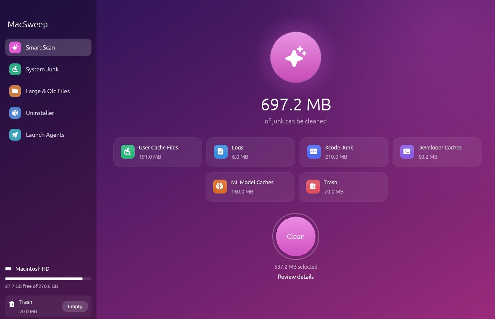
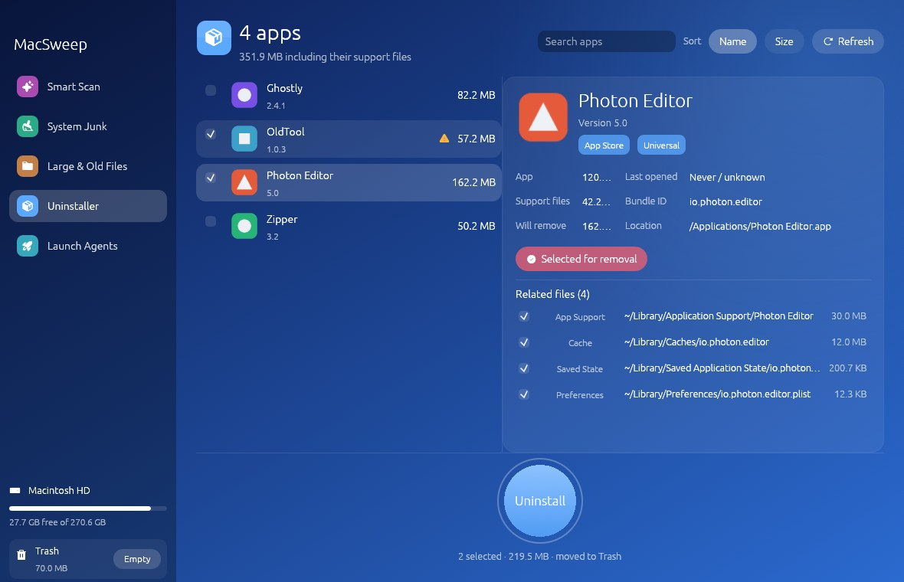
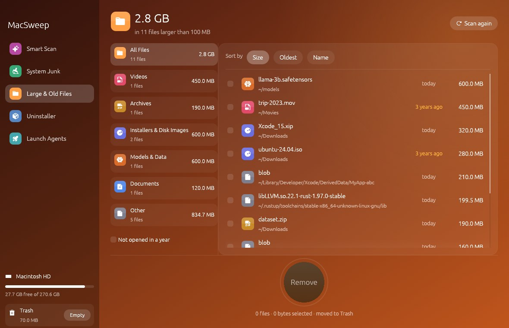
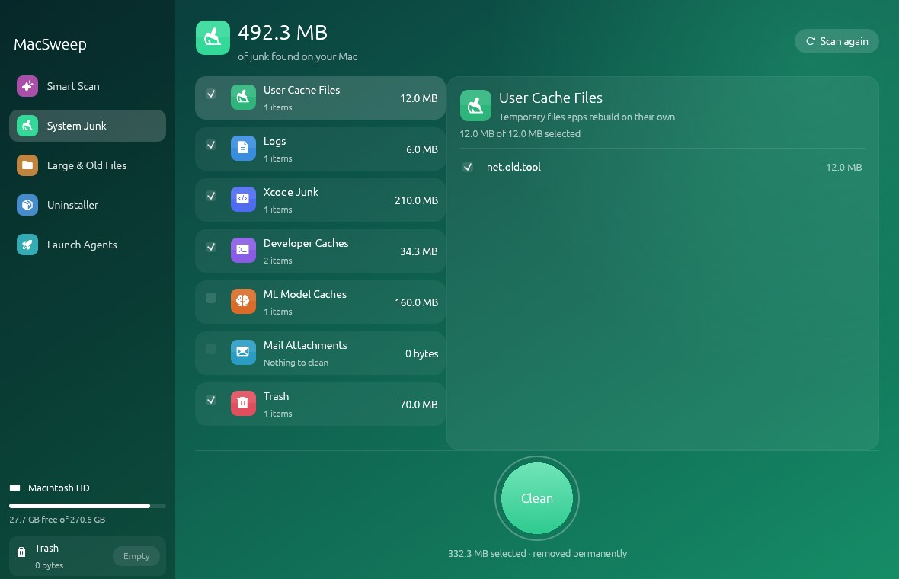
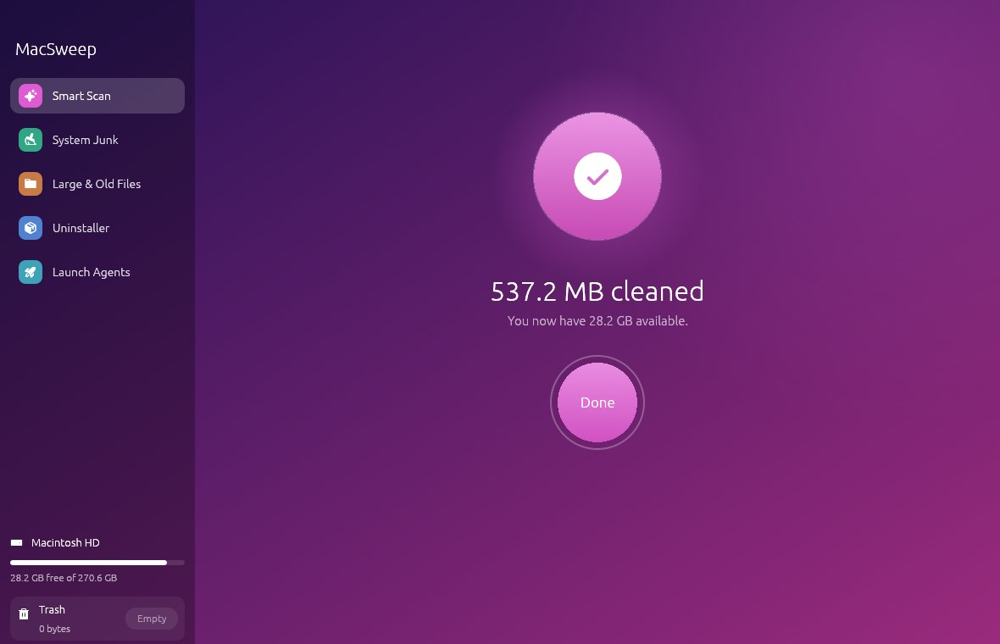

<div align="center">


# MacSweep

**A fast, lightweight Mac cleaner written in Rust.**
Clean junk, find big forgotten files, fully uninstall apps and remove orphaned background items, in a native app of about 7 MB.



[**Download the latest release**](https://github.com/nihal4/macsweep/releases/latest) · Apple Silicon & Intel · macOS 11+

</div>

## Features

| | |
|---|---|
| **Smart Scan** | One click finds caches, logs, build leftovers and Trash, and shows a summary by category. |
| **System Junk** | Review every category and file before cleaning, with per-file checkboxes. Developer and ML-model caches are included (ML caches are off by default). |
| **Large & Old Files** | Scans your home folder for big files, grouped by kind (videos, archives, installers, models & data…), with a "not opened in a year" filter. |
| **Uninstaller** | Every app with its icon, version, App Store / Apple Silicon / Intel badges, last-opened date and **true size including leftovers**. Quits the app, then removes it and its support files. Select several at once. |
| **Launch Agents** | Lists background helpers and flags **orphaned** ones whose app is already gone. |
| **Live disk & Trash** | The sidebar always shows free space and Trash size, updates right after every clean, and has a one-click **Empty Trash**. |

<table>
<tr>
<td></td>
<td></td>
</tr>
<tr>
<td></td>
<td></td>
</tr>
</table>

## Why Rust

- **Fast:** scans use every CPU core (`jwalk` + `rayon`) and run off the UI thread, so the window never freezes.
- **Light:** one native binary drawn with [egui](https://github.com/emilk/egui) and OpenGL, with no browser engine inside. The UI only redraws when something changes, and the system font is memory-mapped instead of copied into RAM.

## Install

1. Download `MacSweep-x.y.z.zip` from [Releases](https://github.com/nihal4/macsweep/releases/latest), unzip it, and move **MacSweep** to Applications.
2. The app isn't notarized by Apple yet, so the first time, right-click it → **Open** → **Open**. Or run:
   ```bash
   xattr -dr com.apple.quarantine /Applications/MacSweep.app
   ```
3. Turn on **System Settings → Privacy & Security → Full Disk Access** for MacSweep, then reopen it. Without this, the Trash and Mail can't be scanned.
4. The first time you remove something, allow MacSweep to control **Finder**. It uses Finder to move files to the Trash, so "Put Back" works.

## Build from source

```bash
curl --proto '=https' --tlsv1.2 -sSf https://sh.rustup.rs | sh   # one-time Rust install
git clone https://github.com/nihal4/macsweep && cd macsweep
./bundle.sh                 # dist/MacSweep.app for this Mac
UNIVERSAL=1 ./bundle.sh     # Apple Silicon + Intel in one app
```

Each rebuild changes the ad-hoc signature, so you may need to switch Full Disk Access off and on again.

## Safety — your data is never touched

Some cleaners have wiped browser profiles and email. MacSweep is built so that **can't happen**:

- **Allowlist, not blocklist.** Junk cleaning can only delete *inside* a fixed list of cache, log and build folders (`JUNK_ROOTS` in `src/fsutil.rs`). Every path is checked again right before deletion.
- **Never touched by cleaning:** browser profiles (Chrome, Brave, Firefox, Safari: history, passwords, bookmarks, logins), Mail, Messages, Keychains, cookies, app containers, `~/Library/Application Support`, and your documents. For browsers, only the disposable download cache in `~/Library/Caches` is cleaned.
- **Sign-in and sync caches are skipped:** iCloud, CloudKit, Apple ID, Wallet, Family, and anything named like a keychain, password manager, token, auth, account or login.
- **The Uninstaller keeps your data unless you ask.** Support files are split into *safe to remove* (cache, logs, preferences, saved window state) and **Your data** (Application Support, containers, cookies, web storage). Your data is never pre-selected.
- **Recoverable by default.** Uninstalled apps, large files and launch agents go to the Trash ("Put Back" works). Only junk is deleted permanently, after you click Clean.
- Apple's own apps (`com.apple.*`) never appear in the Uninstaller.
- Unit tests (`cargo test`) check that browser profiles, Mail, keychains, cookies, Documents and `../` path tricks are never deletable.

## Releasing

Bump `version` in `Cargo.toml`, then:

```bash
git tag v0.1.0 && git push origin v0.1.0
```

GitHub Actions builds a universal `.app` and attaches the zip to a new release (see `.github/workflows/release.yml`).

## Project layout

```
src/main.rs        window, sidebar, Smart Scan, live disk/Trash
src/theme.rs       fonts, colours, gradients, round buttons, cards
src/job.rs         background jobs with progress & cancel
src/fsutil.rs      sizes, delete/trash, disk info, permissions
src/junk.rs        System Junk
src/large.rs       Large & Old Files
src/uninstall.rs   Uninstaller (icons, arch detection, leftovers)
src/agents.rs      Launch Agents
```

## Credits

Icons: [Phosphor](https://phosphoricons.com) (MIT, see `assets/PHOSPHOR-LICENSE`).
Screenshots were taken on a test machine with sample data; on macOS the app uses the system San Francisco font.
